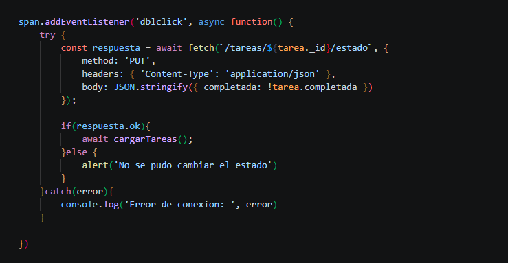

# Gestor de tareas

Aplicación web fullstack para gestionar tareas: una página en HTML, CSS y JavaScript que se comunica con una API REST en Node.js y Express, y guarda los datos en MongoDB. Proyecto de práctica organizado con Scrum (historias de usuario, sprints y retrospectivas).



## Tecnologías

- **Node.js y Express:** servidor y rutas de la API
- **MongoDB (driver oficial):** base de datos de documentos
- **dotenv:** configuración mediante variables de entorno
- **HTML, CSS y JavaScript:** interfaz; `fetch` se comunica con la API sin recargar la página

## Funcionalidades

- Crear tareas con título (no permite títulos vacíos)
- Listar las tareas guardadas, con su estado (pendiente o completada)
- Modificar el título de una tarea
- Cambiar el estado con doble clic (las completadas aparecen tachadas)
- Eliminar tareas con confirmación previa
- Validaciones en el servidor: título obligatorio, ids con formato válido y respuestas `404` cuando la tarea no existe

## Cómo ejecutarlo

1. Clonar el repositorio y entrar a la carpeta:
```powershell
   git clone https://github.com/edwardcaicedo/gestor-tareas.git
   cd gestor-tareas
```
2. Instalar dependencias:
```powershell
   npm install
```
3. Crear el archivo `.env` a partir del ejemplo:
```powershell
   Copy-Item .env.example .env
```
4. Tener MongoDB encendido en el equipo (por defecto en `mongodb://localhost:27017`).
5. Arrancar el servidor:
```powershell
   node index.js
```
6. Abrir **http://localhost:3000** en el navegador.

> Abre la página desde `localhost:3000`, no desde Live Server: la página y la API las sirve el mismo servidor.
>
> Si la terminal dice `No se pudo conectar`, MongoDB no está encendido o la dirección de `MONGO_URI` es incorrecta.

## Endpoints

| Método | Ruta | Descripción |
|---|---|---|
| GET | `/tareas` | Lista todas las tareas |
| POST | `/tareas` | Crea una tarea (`{ "titulo": "..." }`) |
| PUT | `/tareas/:id` | Modifica el título de una tarea |
| PUT | `/tareas/:id/estado` | Cambia el estado (`{ "completada": true }`) |
| DELETE | `/tareas/:id` | Elimina una tarea |

## Cómo lo organicé (Scrum)

| Sprint | Meta | Historias |
|---|---|---|
| 1 | El usuario puede escribir una tarea y verla en una lista | Crear y listar tareas |
| 2 | El usuario puede corregir y completar tareas | Modificar título, marcar y desmarcar |
| 3 | El usuario puede quitar tareas con seguridad | Eliminar con confirmación |

Cada historia tiene criterios de aceptación y se cerró con una revisión y una retrospectiva.

**Pendiente:** filtrar solo las completadas y mostrar el total de tareas.